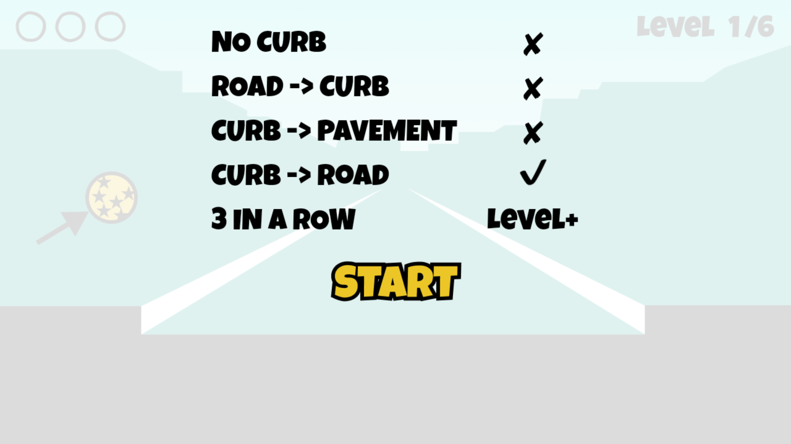
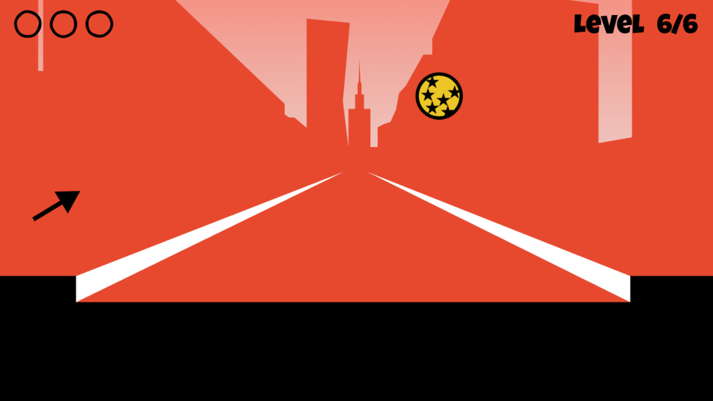

<div align="center">


# Curbs (Krawężniki)

</div>


*2022: git history reconstructed from original file timestamps*

A mobile minigame based on "krawężniki" — a real street game played by bouncing a ball off a curb. Hit the curb across the street, catch the rebound, and do it 3 times in a row to advance. 6 levels, randomized order, free, no ads.

> Co-developed with [Ravenyy](https://github.com/Ravenyy). Built in GDevelop and published to Google Play in February 2022 as "Curbs minigame" — the listing is no longer live. A full rewrite in Godot followed as a separate learning project — see [curbs-godot](https://github.com/nieczuje/curbs-godot).

## Demo

| Rules | Gameplay (Level 6/6) |
|---|---|
| [](screenshots/mobile/rules.png) | [](screenshots/mobile/gameplay-2.png) |

*(gameplay video to be added)*

## Structure

```
game.json               GDevelop project file
static/                 Game images: backgrounds, buttons, score icons
audio/                  Final sound effects
builds/                 Every APK and AAB iteration
experiments/            Side experiments
    randomized_levels/  Version with a shuffled level order
Luckiest_Guy/           Game font and its license
... and 60 other files and folders
```

> [!NOTE]
> Messy structure: this is an old project and the repo root was left as it was. Only the files that matter are listed above.

## Usage

**Android:** Download `game31.apk` from `builds/` and install it on your phone.

**Desktop:** Requires GDevelop 5 (inferred). Open `game.json` in GDevelop and press Preview. Swipe with the mouse.

## Tech

GDevelop, built from events with one JavaScript block for the level shuffle. The ball uses the Physics2 behavior, and throws are read with the Swipe Detector extension.

## Development history

This repo's git history is reconstructed from the real timestamps of the original project files (saved locally rather than version-controlled at the time) — every commit date reflects when that save actually happened, from the earliest prototype (Feb 3, 2022) through the final build submitted to Google Play (Feb 18, 2022). The `builds/` folder keeps every APK/AAB iteration along the way. `experiments/randomized_levels/` is a prototype of the shuffled level order.

## Credits

- Game font: [Luckiest Guy](https://fonts.google.com/specimen/Luckiest+Guy), Apache License 2.0. The license notice is kept in `Luckiest_Guy/LICENSE.txt`.
- Swipe detection for the throw: [Swipe Detector](https://forum.gdevelop.io/t/extension-swipe-detector/29005), a GDevelop extension by e1e5en.
- [Bounce (using forces)](https://wiki.gdevelop.io/gdevelop5/extensions/bounce/), a GDevelop extension by 4ian. It is included in the project, but no event uses it.
<!-- TODO: add licenses of Swipe Detector and Bounce -->
<!-- TODO: credit sounds -->
<!-- TODO: credit asset-store images in assets/ and experiments/randomized_levels/ -->

## License

MIT License — see [LICENSE](LICENSE).

<div align="right">

*README written with AI assistance.*

</div>
